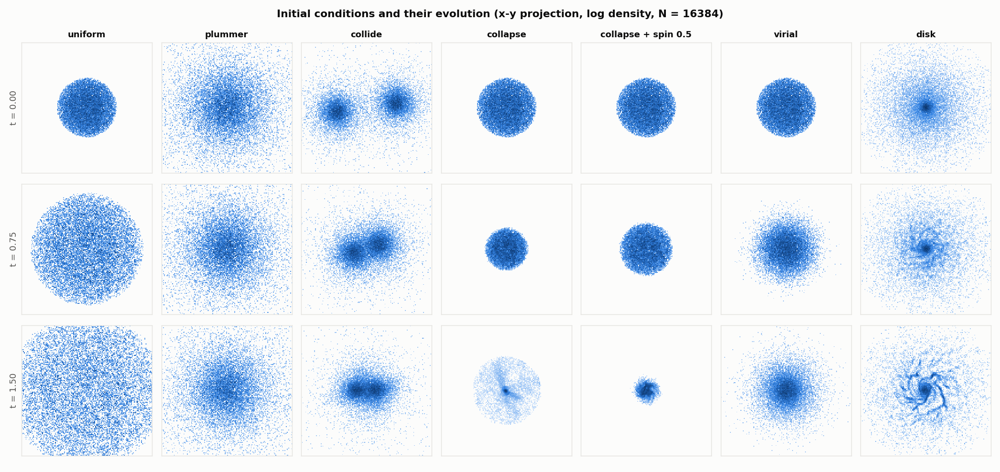

# Adaptive Scheduling for Load-Balanced Parallel N-Body Simulation
### A Hybrid OpenMP–MPI–CUDA Approach — PCAP course project

Tanish Hemant Kuvar (240962540) · M. Vishal Kumar (240962546) · Samyak Jain (240962638) — AIML-A

A gravitational N-body simulator (Barnes–Hut, θ = 0.5, leapfrog) parallelised with **MPI** across
ranks, **OpenMP** across cores and **CUDA** on the GPU, plus a lightweight **adaptive controller**
that measures per-thread loop times and switches the OpenMP schedule between `static` and
`dynamic` at run time (`omp_set_schedule`, no custom runtime).

All four objectives of the synopsis are implemented and evaluated:

| Objective | Where |
|---|---|
| **O1** sequential direct-sum and Barnes–Hut baselines with energy and momentum checks | `--force direct`, `--force bh` with `--threads 1`; checks: `scripts/validate.py` |
| **O2** OpenMP force computation; static / dynamic / guided characterised | `src/forces.c` (`schedule(runtime)`), experiment `sched` |
| **O3** MPI distribution (`MPI_Allgatherv`) and a CUDA force kernel | `src/main.c`, `src/gpu.c` (tiled direct kernel + near-field kernel) |
| **O4** adaptive controller, evaluation on uniform and clustered inputs | `src/sched.c`, experiments `sched`, `mpi`, `ctl`, `small` |

Results and discussion: **[RESULTS.md](RESULTS.md)** · raw tables: `results/summary.md` ·
validation: `results/validation.md` · figures: `results/figures/`.

---

## Quick start (for collaborators)

```bash
git clone https://github.com/tanishkuvar11/N-Body-Simulation.git
cd N-Body-Simulation
python -m pip install -r requirements.txt   # numpy, matplotlib
python build.py --fetch-cuda                # first time: also downloads CUDA headers + NVRTC (~80 MB)
python scripts/validate.py                  # should print 7/7 checks passed
python demo.py                              # the 5-part demo
```

You need MinGW-w64 GCC and MS-MPI first (see Building, below). If you have no NVIDIA GPU, skip
`--fetch-cuda`: the CPU, OpenMP and MPI parts work the same, and only the `gpu-direct` / `bh-gpu`
modes (and validation checks V2–V3) are unavailable. The easiest way to get MS-MPI with Anaconda is
`conda install -c conda-forge msmpi`, which provides `mpiexec` and the headers that `build.py` looks for.

Not in the repository (regenerated locally): `bin/` (`python build.py`), `third_party/`
(`--fetch-cuda`), and the raw animation snapshots (`python scripts/animate.py`). The committed
`results/` are the measurements from our machine (i7-14700HX + RTX 4060); your timings will differ.
The final-state checksum is bit-identical across thread counts, ranks and schedules *on one
machine/compiler*, but a different CPU or compiler (`-march=native`) can legitimately give a
different checksum.

## 1. Building

Requirements (Windows, as used for the results):

* MinGW-w64 GCC with OpenMP (tested: GCC 15.1)
* MS-MPI — runtime + headers (MS-MPI SDK, or `conda install msmpi`, which also provides `mpiexec`)
* Python 3 (build and benchmark scripts; `matplotlib` for figures)
* For the GPU modes: an NVIDIA driver, and the CUDA **headers + NVRTC** only — no `nvcc` and no
  Visual Studio. `python build.py --fetch-cuda` installs them into `third_party/cuda` (it runs
  `pip install --target third_party/cuda nvidia-cuda-nvrtc-cu12 nvidia-cuda-runtime-cu12`).

```bash
python build.py
```

`build.py` finds gcc, MS-MPI and the CUDA headers, creates an import library for `msmpi.dll`,
compiles `bin/nbody.exe`, and copies `msmpi.dll` and the NVRTC DLLs next to it. Without CUDA headers
(or with `--no-cuda`) it builds a CPU-only binary. On Linux it uses `mpicc`.

**Why NVRTC?** CUDA's `nvcc` needs the MSVC host compiler on Windows. Instead, the CUDA kernels are
compiled **at run time** by NVRTC for the detected GPU (native `sm_XY` cubin, with a PTX fallback)
and launched through the CUDA Driver API. Both libraries are loaded dynamically, so the executable
also runs on machines without a GPU, and only the GPU modes then report an error.

## 2. Running

```bash
# one rank, 8 threads pinned to P-cores, adaptive schedule, colliding clusters
bin/nbody.exe --ic collide --n 65536 --steps 150 --threads 8 --pin --sched adaptive

# hybrid: 4 MPI ranks x 2 threads
mpiexec -n 4 bin/nbody.exe --ic collapse --n 65536 --threads 2 --pin --sched adaptive

# CUDA: tiled direct kernel (single precision), and the Barnes-Hut + GPU near-field hybrid
bin/nbody.exe --force gpu-direct --gpu-float --n 65536 --verify
bin/nbody.exe --force bh-gpu --gpu-float --leaf 256 --n 65536 --threads 8 --pin --verify
```

| option | meaning (default) |
|---|---|
| `--ic uniform\|plummer\|collide\|collapse\|virial\|disk` | initial conditions (`plummer`); `disk` = rotating disk galaxy with a bulge |
| `--spin S` | add solid-body rotation about z to any input (0; 1 ≈ circular speed at the rms radius) |
| `--n`, `--steps`, `--dt`, `--eps`, `--theta`, `--leaf` | bodies (4096), steps (100), timestep (0.01), softening (0.05), opening angle (0.5), bodies per tree leaf (8) |
| `--force bh\|direct\|gpu-direct\|bh-gpu` | force back end (`bh`) |
| `--sched static\|dynamic\|guided\|adaptive` | OpenMP schedule (`static`) |
| `--threads T`, `--chunk C` | OpenMP threads per rank (1), dynamic/guided chunk (8) |
| `--k K`, `--low L`, `--high H` | controller check interval (5) and hysteresis thresholds (0.05 / 0.15) |
| `--balanced dynamic\|guided\|auto` | adaptive: schedule used once imbalanced (`dynamic`); `auto` tries dynamic(C), dynamic(8C) and guided(C) and keeps the fastest |
| `--partition equal\|cost` | MPI rank blocks: equal body counts, or equal measured work (cost zones) (`equal`) |
| `--pin`, `--cpus LIST` | pin threads: one per physical core, fastest cores first / an explicit CPU list |
| `--gpu-float`, `--near-cap C` | single-precision GPU kernels / near-field ranges per body (128) |
| `--verify` | compare the initial forces with an exact direct sum (prints RMS / max relative error) |
| `--diag D`, `--no-energy` | energy/momentum check every D steps (start/end only by default), or none |
| `--trace FILE`, `--csv FILE`, `--label X` | per-step imbalance/policy trace (plus energy at `--diag` steps); append a summary row |
| `--snap FILE`, `--snap-every K` | positions + owning thread every K steps, for the animation |

Every run ends with a machine-readable `RESULT key=value …` line, which includes a bitwise
checksum of the final state.

### Demo (about 5 minutes)

```bash
python demo.py                  # 5 parts with a pause between them; --no-pause, --part N
```

It covers correctness (force error, the same checksum for every schedule), adaptive vs static on a
collapsing cloud with live λ values, 1 rank × 8 threads vs 4 ranks × 2 threads with the same
checksum, the CUDA kernels, and finally opens the result figures.

### Animation

```bash
python scripts/animate.py            # runs static + adaptive on the collapse, writes results/animation.mp4
python scripts/animate.py --live     # same, in a window
```

The animation shows static and adaptive side by side. Every star is coloured by the OpenMP thread
that computes its force, and bar charts show the per-thread loop time. Under static, each thread
owns a region of space, and the threads owning the forming core fall behind (λ ≈ 0.5–0.6). After
the adaptive controller switches to dynamic, the colours mix and the bars level out. A marker shows
the moment of the switch; before it, both runs use the same schedule, so any gap there is timing
noise. Snapshots are written with `--snap FILE --snap-every K`, and recording them does not change
the results.

### More visuals

```bash
python scripts/visualize.py     # 6 extra figures -> results/figures/extra/  (about a minute)
python scripts/export_web.py    # interactive 3D viewer -> results/web/viewer.html
```

| figure | shows |
|---|---|
| [`ic_gallery.png`](results/figures/extra/ic_gallery.png) | all 7 inputs (incl. disk galaxy and spinning collapse) at t = 0, 0.75, 1.5 |
| [`imbalance_by_ic.png`](results/figures/extra/imbalance_by_ic.png) | work imbalance a static schedule would have, over time, per input |
| [`energy_drift.png`](results/figures/extra/energy_drift.png) | relative energy error over time, per input |
| [`phase_breakdown.png`](results/figures/extra/phase_breakdown.png) | force / communication / sort / tree / integration time per ranks × threads split |
| [`mpi_heatmap.png`](results/figures/extra/mpi_heatmap.png) | speedup over the ranks × threads grid |
| [`efficiency_heatmap.png`](results/figures/extra/efficiency_heatmap.png) | parallel efficiency for every input × schedule × thread count |

`results/web/viewer.html` is one self-contained page: open it in a browser (it loads three.js from a
CDN) to orbit, zoom and scrub through four scenarios. It colours each star by the thread that
computed it, or by speed, and shows the live per-thread loop times, λ and the active schedule.
Some browsers block large local files; in that case serve the folder with
`python -m http.server --directory results/web` and open `http://localhost:8000/viewer.html`.



### Reproducing everything

```bash
python build.py
python scripts/validate.py      # 7 correctness checks  -> results/validation.md
python scripts/bench.py         # all experiments, 3 repetitions (several hours) -> results/*.csv
python scripts/analyze.py       # figures + tables -> results/figures/, results/summary.md
```

The future-work extensions (see Design) have their own experiment, analysis and validation output:

```bash
python scripts/bench.py --exp future --gate-every 0 --out results/future
python scripts/analyze_future.py                 # -> results/future/summary.md, future.png
python scripts/validate.py --out results/future/validation.md
```

`bench.py --quick --reps 1` runs a small smoke-test version in a few minutes. `bench.py` includes a
**thermal gate**: before every 8 runs it repeats a reference configuration and waits until the CPU
is within 8 % of its reference speed (`--gate-*` options). Laptops throttle during long sessions, and
the throttled first measurements of the later experiments are kept in `results/archive/` for
transparency.

## 3. Design

### Timestep (every rank)

1. half-kick and drift the rank's own block of bodies (velocity Verlet / leapfrog KDK)
2. `MPI_Allgatherv` of positions and velocities, so every rank holds the full state
3. **Morton (Z-order) sort** of all bodies (stable radix sort, identical on every rank)
4. build the Barnes–Hut octree (replicated, as in the synopsis)
5. compute forces for the own block: an OpenMP loop with `schedule(runtime)`, plus CUDA where selected
6. second half-kick
7. controller: record per-thread loop times; every k steps possibly call `omp_set_schedule`

**Why sort?** Sorting along the Morton curve makes a contiguous index range a compact region of
space, so block partitions over ranks and threads become spatial domains (as in Singh et al.'s
cost-zones). This makes the tree walk cache-friendly, and it is also exactly what makes clustering
show up as load imbalance under `static`. With random body order, every block would contain a
random mix of dense and sparse bodies.

**Octree.** Built top-down from the sorted keys: every cell owns a contiguous body range, children
are found by binary search on the next 3 key bits, and single-child chains are collapsed, so there
are at most 2N−1 nodes. Each node stores its centre of mass, mass, size² and body range. The walk
accepts a cell when `s/d < θ` and the cell does not contain the body itself (an index-range test),
so no self-interaction can ever come from a centre of mass.

### The adaptive controller (Algorithm 1)

Imbalance λ = max(tᵢ)/mean(tᵢ) − 1 over the per-thread loop times, accumulated over the k steps of a
check window. Hysteresis: `STATIC → DYNAMIC(c)` when λ > high, `DYNAMIC → STATIC` when λ < low.

One point needs care, and the synopsis's Algorithm 1 does not address it. **Under `dynamic`, the
measured thread times are balanced by construction.** Using them directly would make λ always
look small, so the controller would flip back to static at every check and oscillate. While
`dynamic` is active, the controller therefore evaluates the thread times that `static` *would*
produce:

  t̂ᵢ = Bᵢ / vᵢ, where Bᵢ is the work in thread i's static block and vᵢ = Wᵢ / tᵢ is thread i's measured speed

Work is counted per body as tree nodes visited plus interactions; Wᵢ is the work thread i actually
executed. Under `static`, Wᵢ = Bᵢ, so t̂ᵢ = tᵢ exactly, which is the synopsis's metric. Under
`dynamic`, the prediction covers both workload clustering and differences in core speed (for
example P- vs E-cores, or OS interference).

### CUDA

* **`gpu-direct`**: tiled all-pairs kernel (Nyland et al., GPU Gems 3 ch. 31). Each block stages
  256 bodies at a time in shared memory. Double or single precision (`-DREAL=…` at NVRTC compile time).
* **`bh-gpu`** (hybrid): OpenMP threads walk the tree and accumulate the far field (cell
  interactions). Near-field leaves are recorded as body *ranges*, which are contiguous thanks to the
  Morton order, with adjacent ranges merged. A GPU kernel then evaluates all near-field pairs, and
  the results are summed. If a body's range list is full, the extra leaves are computed on the CPU,
  so results are exact in every case. The CPU walk is still the loop the controller schedules.

### Parallel correctness by construction

Each body's force is computed with the same operation sequence no matter which rank or thread owns
it, and every rank sorts and builds the same tree from the same data. The final state is therefore
**bit-identical** for every schedule, thread count, rank count and controller decision. This is
checked by a checksum in validation check V1.

### Extensions (the former "future work")

* **Cost-weighted MPI partitioning** (`--partition cost`). Each body's cost (tree nodes visited +
  interactions) is all-gathered after the force phase and permuted with the Morton sort. After the
  sort, every rank cuts the Morton order into `P` pieces of equal summed cost (`partition_by_cost`
  in `src/morton.c`). All ranks hold the same costs, so they compute the same cut without extra
  communication. This fixes the rank-level imbalance that the OpenMP controller cannot reach.
* **Parallel Morton sort and tree build.** The sort is a parallel sample sort: splitters from a
  sorted key sample, one stable scatter into one bucket per thread, then a per-bucket LSD radix
  sort. The tree is built top-down with OpenMP tasks for subtrees above 4096 bodies, with node slots
  claimed atomically. Both run sequentially below N = 32768 (`PAR_MIN`), where measurement showed
  no gain; libgomp barriers cost about 50 µs on Windows.
* **Controller auto mode** (`--balanced auto`). On each static → balanced switch, the controller
  tries dynamic(C), dynamic(8C) and guided(C) for one k-step window each. It measures throughput
  (work units per second of the slowest thread, which normalises for workload drift) and keeps the
  fastest. The imbalance check keeps running during the trial.

All three keep the bit-identical final state (validation V1 and V1b).

### Timing

MinGW's `omp_get_wtime()` has only 1 ms resolution, so all timing uses `QueryPerformanceCounter`
(`wtime()` in `src/sched.c`).

## 4. Repository layout

```
build.py               build script (Windows MinGW + MS-MPI, or Linux mpicc)
src/nbody.h            shared types and declarations
src/main.c             driver: CLI, MPI decomposition, time loop, diagnostics, CSV/trace output
src/init.c             initial conditions + deterministic RNG (xoshiro256**)
src/morton.c           Morton keys, parallel sample sort, permutation, cost-weighted rank partition
src/tree.c             Barnes-Hut octree construction (OpenMP tasks)
src/forces.c           direct / Barnes-Hut / GPU / hybrid force loops, energy diagnostics
src/sched.c            adaptive controller, imbalance metrics, high-resolution clock
src/affinity.c         thread pinning (P-cores first via EfficiencyClass)
src/gpu.c, gpu.h       CUDA kernels (NVRTC) + Driver API back end, dynamically loaded
demo.py                live demo for the presentation
scripts/validate.py    correctness checks
scripts/bench.py       benchmark experiments
scripts/analyze.py     figures and tables
scripts/animate.py     static-vs-adaptive animation (uses --snap)
scripts/analyze_future.py  tables + figure for the extensions -> results/future/
scripts/visualize.py   extra figures (input gallery, energy, phase breakdown, heatmaps)
scripts/export_web.py  interactive 3D viewer (template: scripts/viewer_template.html)
results/               CSVs, traces, figures, summary.md, validation.md
third_party/cuda/      CUDA headers + NVRTC (pip wheels; build/run time only)
```

## 5. Deviations from the synopsis (and why)

* **Controller metric under `dynamic`**: see above. Without it, Algorithm 1 would oscillate.
* **Measurement window**: λ is computed from thread times accumulated over the k steps of the window,
  not from one step, because single-step timings on a laptop are noisy.
* **Uniform input**: a uniform sphere in homologous (Hubble-like) expansion. Its density stays
  uniform, so it is a true balanced-workload control. A "virialised" uniform sphere (`--ic virial`)
  is not an equilibrium: it forms a dense core within about one time unit.
* **Cold collapse** (`--ic collapse`) was added next to Plummer and colliding clusters, because it
  starts uniform and clusters *during* the run. That is exactly the situation that motivates
  run-time switching.
* **Thread pinning** (`--pin`) was added because the i7-14700HX mixes P- and E-cores. Unpinned,
  thread-speed differences alone produced λ ≈ 0.3 on a perfectly balanced workload.
