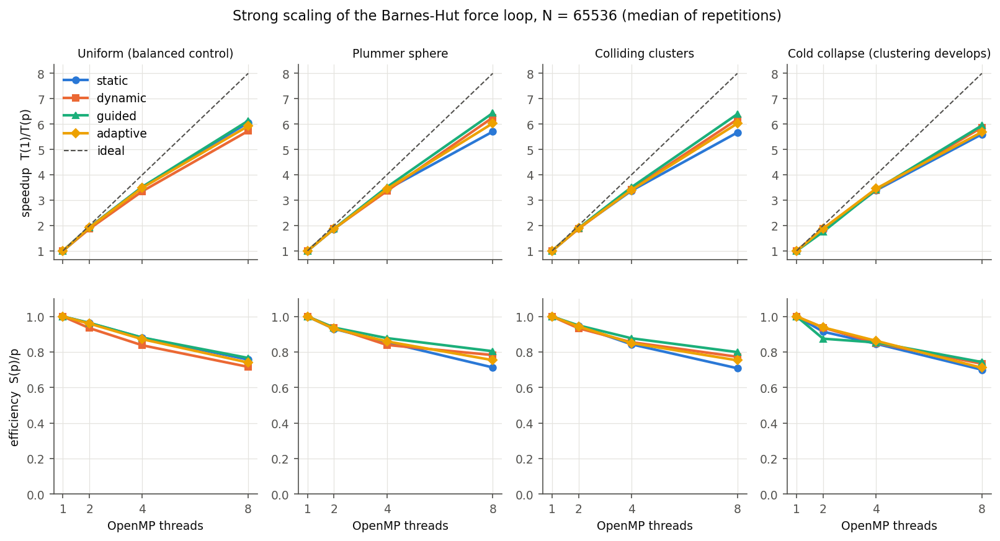
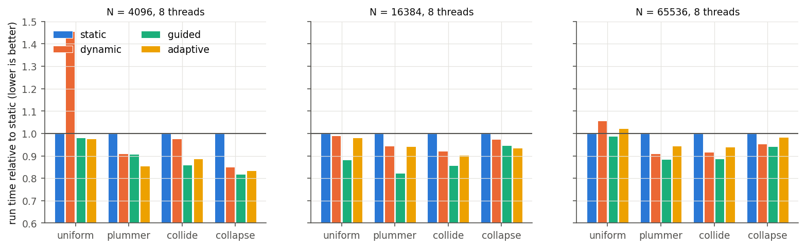
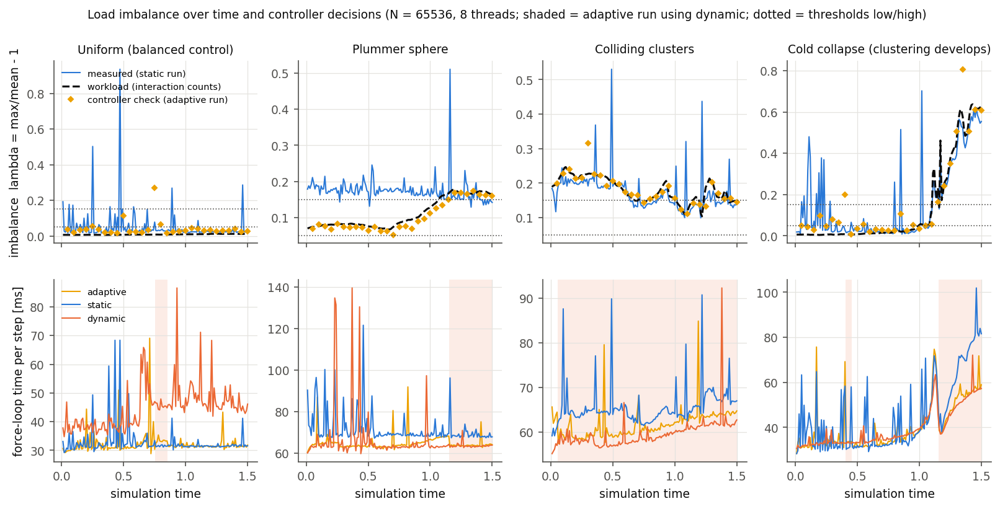
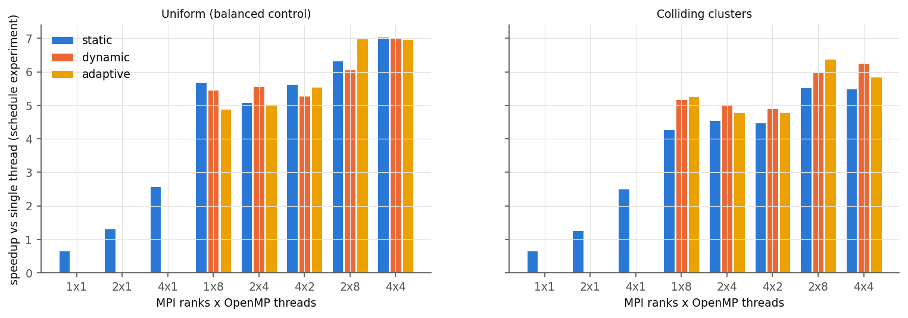
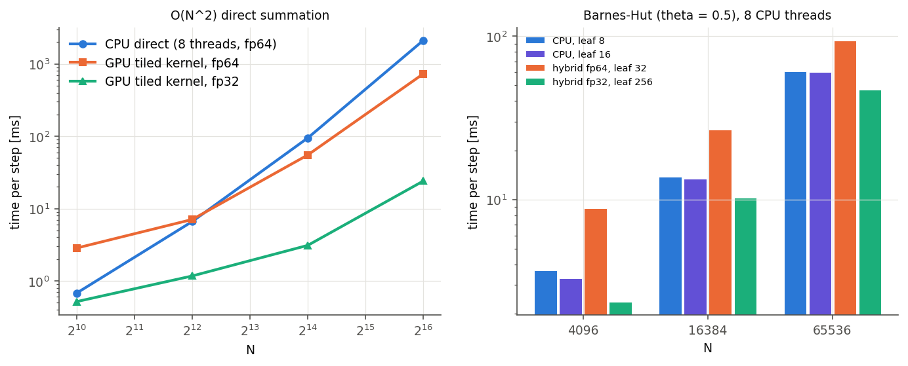

# Results and discussion

All numbers come from `results/*.csv`, produced by `scripts/bench.py`: medians of 3 repetitions,
run in shuffled order. Full tables are in `results/summary.md`, and the figures in `results/figures/`
are produced by `scripts/analyze.py`.

**Platform.** Intel Core i7-14700HX (8 P-cores + 12 E-cores, 28 logical CPUs), NVIDIA RTX 4060 Laptop
GPU (8 GB), Windows 11, MinGW-w64 GCC 15.1 `-O3 -march=native`, MS-MPI 10.1, CUDA 13.0 driver with
NVRTC 12.9. Threads are pinned one per P-core (`--pin`) unless stated otherwise.

**Workload.** Barnes–Hut, θ = 0.5, leaves of 8 bodies, softening ε = 0.05, dt = 0.01, 150 steps
(t = 1.5), G = M = 1.

| input | description | work imbalance under static (8 threads) |
|---|---|---|
| `uniform` | uniform sphere in homologous expansion: density stays uniform | 0.006 → 0.012 (balanced control) |
| `plummer` | Plummer sphere in equilibrium (virial ratio 0.99) | 0.07 → 0.16 |
| `collide` | two Plummer spheres on a collision course | 0.13 – 0.23 |
| `collapse` | cold uniform sphere: uniform at first, dense core after t ≈ 1.1 | 0.007 → 0.62 |

---

## 1. Correctness (`results/validation.md`)

| check | result |
|---|---|
| Bit-identical final state across 10 configurations (1–4 ranks, 1–8 threads, all four schedules, forced controller switching, pinned/unpinned) | **PASS**: a single checksum |
| CUDA tiled direct kernel vs CPU direct sum | **PASS**: double precision rms 1.8e-16; single precision rms 1.6e-6 |
| BH+GPU hybrid vs CPU Barnes–Hut (also with the CPU overflow path forced) | **PASS**: identical force error to 7 digits |
| Barnes–Hut force error vs θ (0.3 / 0.5 / 0.7 / 0.9) | **PASS**: rms 0.05 % / 0.25 % / 0.62 % / 1.16 %, increasing monotonically |
| Energy and momentum (Plummer, N = 4096, t = 2) | **PASS**: direct ΔE/E 1.1e-7, \|P\| 4e-17; Barnes–Hut ΔE/E 1.4e-5 |
| Leapfrog order: halving dt cuts ΔE by 4.05× and 4.02× | **PASS**: second order |
| Plummer initial conditions in equilibrium | **PASS**: 2KE/\|W\| = 0.986 |

## 2. OpenMP scaling and schedule comparison (objective O2)

**Speedup at 8 threads, N = 65,536** (single-thread static baseline; efficiency in brackets):

| input | static | dynamic | guided | adaptive |
|---|---|---|---|---|
| uniform | 6.06× (76 %) | 5.73× (72 %) | **6.13× (77 %)** | 5.92× (74 %) |
| plummer | 5.70× (71 %) | 6.26× (78 %) | **6.44× (81 %)** | 6.03× (75 %) |
| collide | 5.67× (71 %) | 6.18× (77 %) | **6.39× (80 %)** | 6.02× (75 %) |
| collapse | 5.60× (70 %) | 5.87× (73 %) | **5.95× (74 %)** | 5.69× (71 %) |

Even with a perfectly balanced schedule, efficiency stays around 75–80 %. The main reasons are the
sequential, replicated Morton sort and tree build (about 3 ms per step, roughly 8 % of a
65,536-body step at 8 threads), memory bandwidth in the tree walk, and timing noise on a laptop.

**Run time relative to static at 8 threads** (< 1 is faster):

| N | input | dynamic | guided | adaptive |
|---|---|---|---|---|
| 4,096 | uniform | 1.455 | 0.981 | 0.978 |
| 4,096 | plummer | 0.910 | 0.909 | 0.856 |
| 4,096 | collide | 0.978 | 0.860 | 0.887 |
| 4,096 | collapse | 0.850 | 0.818 | 0.834 |
| 16,384 | uniform | 0.990 | 0.883 | 0.981 |
| 16,384 | plummer | 0.945 | 0.823 | 0.941 |
| 16,384 | collide | 0.921 | 0.857 | 0.902 |
| 16,384 | collapse | 0.975 | 0.947 | 0.935 |
| 65,536 | uniform | 1.058 | 0.988 | 1.023 |
| 65,536 | plummer | 0.911 | 0.886 | 0.945 |
| 65,536 | collide | 0.916 | 0.886 | 0.941 |
| 65,536 | collapse | 0.954 | 0.942 | 0.985 |

Findings:

1. **Clustering really does make static imbalanced.** At 8 threads, *every* load-balancing schedule
   beats static on *every* clustered input (27 of 27 cases), saving 1.5–18 % of the run time. At 2–4
   threads the effect is smaller and within noise (3 of 27 clustered cases at 4 threads were slightly
   slower than static), since an extra-heavy block costs less when there are fewer blocks.
2. **The synopsis's predictions hold.** Adaptive stays within a few percent of static on the uniform
   input (−2.3 % to +2.2 % at 8 threads) and beats it on every clustered input (9 of 9 cases at 8 threads,
   saving 1.5 % to 16.6 %).
3. **Adaptive avoids dynamic's worst case.** On the small uniform problem (N = 4096), `dynamic` with
   chunk 8 is 46 % *slower* than static: per-chunk dispatch and the loss of Morton locality outweigh
   any balancing. Adaptive stays on static there (0.98).
4. **Fixed `guided` was the best single schedule** in 9 of 12 cases at 8 threads. Its large leading
   chunks are contiguous Morton ranges, which keeps cache locality like static, and its small trailing
   chunks absorb the imbalance like dynamic. **Adaptive did not beat dynamic or guided overall.** It
   spends the balanced early part of every run in static, and dynamic with chunk 8 is not the best
   balanced schedule (see §5: chunk 64–512 is about 2–3 % faster than chunk 8).

So the answer to the research question is: **compared with fixed static, yes.** A run-time controller
built only on `omp_set_schedule` removes static's clustering penalty automatically and stays
within about 2 % of static on balanced input (apart from the noise-triggered switch described in §3). **Compared with the best fixed schedule (guided) on this machine, no.** Here the
best balancing schedule is cheap enough to leave on all the time.

**Imbalance over time** (N = 65,536, 8 threads). The dashed line is the imbalance implied by the
counted work per static block, and the blue line is what static actually measured. In the cold
collapse, λ stays below 0.05 until t ≈ 1.0 and then rises to 0.6 as the core forms. The controller's
checks (orange diamonds) follow this curve, and the adaptive run switches to dynamic (shaded band) as
static's step time starts to climb. On the uniform input, the measured λ is mostly timing noise
(spikes up to 0.9 against a work imbalance of 0.01). This is why the controller accumulates times over
a k-step window and uses hysteresis.

## 3. Hybrid MPI × OpenMP (objective O3)

N = 65,536, 100 steps. Speedups are against the single-thread run of the schedule experiment. That is
the conservative baseline: single-core turbo was about 1.5× lower during the later MPI session, so
same-session 1 × 1 speedups would look inflated (see `results/summary.md`).

| ranks × threads | uniform (best schedule) | collide: static → adaptive | rank imbalance (collide, static) | comm per 100 steps |
|---|---|---|---|---|
| 2 × 1 / 4 × 1 | 1.32× / 2.59× | 1.26× / 2.50× | 0.02 / 0.08 | 0.6–1.8 s |
| 1 × 8 | 5.69× | 4.30× → **5.26×** | 0 | 0 |
| 2 × 4 | 5.56× | 4.56× → 4.78× | 0.04 | 0.5 s |
| 4 × 2 | 5.62× | 4.48× → 4.79× | 0.11 | 1.4 s |
| 2 × 8 (SMT) | **6.99×** | 5.52× → **6.38×** | 0.02 | 0.2 s |
| 4 × 4 (SMT) | **7.04×** | 5.50× → 5.85× | 0.07 | 0.7 s |

* All rank × thread combinations give the **same answer bit for bit** (validation check V1).
* With the same 8 cores, **1 × 8 is the fastest split**. Each extra rank repeats the sort and tree
  build and adds an `MPI_Allgatherv`. On a single shared-memory node, ranks cost more than threads.
* Adaptive improves on static in every MPI configuration on the clustered input, saving 5–18 %.
* **A false switch on noise.** On the uniform input at 1 × 8, adaptive was slower than static (median
  4.40 s vs 3.77 s; static itself varied 3.69–4.18 s between repetitions). In two of the three
  repetitions, a timing spike pushed the window λ above 0.15 although the work imbalance was only
  0.007, so the controller switched to dynamic. It stayed there for 20–40 % of the run, because the
  noisy prediction did not fall below the 0.05 return threshold. On a quiet machine, or with a higher
  `--high` threshold, this does not happen; it is the main limitation of a time-based trigger.
* **Imbalance between ranks grows with the number of ranks** (λ_rank up to 0.11 on the clustered
  input). The OpenMP controller cannot fix that, because it only rebalances threads *inside* a rank.
  This is exactly the cross-node level that Müller Korndörfer et al. [11] left open; cost-weighted
  partitioning of the Morton order across ranks would be the natural next step.
* With SMT (16 hardware threads on the 8 P-cores), 7.0× is reached.

## 4. CUDA (objective O3)

**Tiled direct summation**, time per step:

| N | CPU direct, 8 threads | GPU fp64 | GPU fp32 | fp32 vs CPU | fp32 rms error |
|---|---|---|---|---|---|
| 1,024 | 0.68 ms | 2.84 ms | 0.52 ms | 1.3× | 6.0e-7 |
| 4,096 | 6.62 ms | 7.07 ms | 1.17 ms | 5.7× | 1.1e-6 |
| 16,384 | 94.7 ms | 55.1 ms | 3.10 ms | 31× | 2.3e-6 |
| 65,536 | 2117 ms | 730 ms | 24.0 ms | **88×** | 4.6e-6 |

At N = 65,536 the single-precision kernel computes an *exact* O(N²) sum (24 ms) faster than the
8-thread CPU Barnes–Hut approximation (about 60 ms). Double precision is held back by this laptop
GPU, whose FP64 throughput is 1/64 of FP32.

**Barnes–Hut CPU vs BH+GPU hybrid**, 8 threads:

| N | best CPU (leaf 8/16) | hybrid fp64, leaf 32 | hybrid fp32, leaf 256 | fp32 hybrid vs CPU | rms force error (CPU / hybrid) |
|---|---|---|---|---|---|
| 4,096 | 3.31 ms | 8.82 ms | 2.38 ms | 1.39× | 0.35 % / 0.14 % |
| 16,384 | 13.4 ms | 26.8 ms | 10.3 ms | 1.30× | 0.23 % / 0.11 % |
| 65,536 | 60.4 ms | 94.2 ms | 46.8 ms | 1.29× | 0.15 % / 0.09 % |

The hybrid pays off only when the leaves are large. Then most of the work is near-field pairs, which
the GPU handles well, and the CPU tree walk becomes shallow. With small leaves the CPU walk dominates
and the GPU work is too small to cover the transfer cost. Large leaves also make the hybrid *more*
accurate, because more interactions are computed exactly.

## 5. Controller sensitivity and scheduling overhead (objective O4)

Cold collapse, N = 65,536, 8 threads:

| setting | time | switches |
|---|---|---|
| k = 1 / 5 / 10 / 20 | 6.34 / 6.34 / 6.51 / 7.13 s | 7 / 1 / 1 / 1 |
| high = 0.10 / 0.15 / 0.25 / 0.40 (low = high/3; 0.05 for 0.15) | 7.37 / 6.34 / 6.06 / 6.76 s | 5 / 1 / 1 / 1 |

Checking too rarely (k = 20) reacts late to the collapse, and a very low threshold (0.10) switches
on noise. k = 1–5 with high ≈ 0.15–0.25 works best. The hysteresis keeps the number of switches small.

Dynamic chunk size (collide, N = 65,536, 8 threads): static 10.43 s; dynamic chunk 1 / 8 / 64 / 512 =
10.80 / 9.56 / 9.33 / 9.35 s. Chunk 1 is slower than static because of dispatch cost and lost locality.

Scheduling overhead at small N (uniform, 8 threads, 400 steps): at N = 1024, static 0.120 s, dynamic
chunk 1 0.139 s (+16 %), chunk 8 0.128 s (+7 %), adaptive 0.128 s. At N = 2048, adaptive 0.232 s is
slightly *faster* than static (0.238 s), while dynamic chunk 1 is +16 %.

## 6. Extension: switching to guided instead of dynamic

Because guided won the main comparison, we also tested `--balanced guided` (the controller switches
static → guided). Results are in `results/summary.md` §6. The comparison is **inconclusive**. Even
after normalising each run by the static run of the same repetition, the ratios vary widely between
repetitions (for example 1.07–1.95 for one configuration) on this throttling laptop. No variant is
consistently best: guided-switching won some cells (Plummer, N = 16,384: 0.87 vs 0.97 for fixed guided)
and lost others (collapse, N = 16,384: 1.14 vs 0.91 for the default controller). We report it as a
tested idea without a measurable benefit. The default stays `dynamic`, as in the synopsis.

## 7. Threats to validity and how they were handled

* **Hybrid CPU.** Unpinned threads on P- and E-cores produced λ ≈ 0.3 on a balanced workload. All
  benchmarks pin one thread per P-core; the P-cores are detected automatically through Windows'
  `EfficiencyClass`.
* **Thermal throttling and turbo.** Long benchmark sessions slowed the laptop by up to about 40 %.
  The first measurements of the later experiments were therefore discarded (archived in
  `results/archive/`) and re-run behind a *thermal gate*: before every 8 runs, a calibration run had to
  be within 8 % of its reference time (`results/calib.csv`). Within each repetition, runs are shuffled
  so that drift affects all schedules equally. The main schedule experiment was stable (repetitions
  agree within 1.2 %). Single-core turbo still differed between sessions, which is why MPI speedups
  are reported against the conservative baseline.
* **Timer resolution.** MinGW's `omp_get_wtime` has 1 ms resolution, so all timing uses
  `QueryPerformanceCounter`.
* **Single machine.** "MPI across nodes" was evaluated with ranks on one node, where MPI costs more
  than it gains. On a real cluster the trade-off between ranks and threads would differ.

## 8. Conclusions

1. A complete, verified hybrid MPI + OpenMP + CUDA Barnes–Hut simulator. Its results are
   bit-reproducible across every parallel configuration, and its physics is validated (force
   accuracy, energy and momentum conservation, second-order integrator).
2. As bodies cluster, an equal split of bodies no longer gives an equal split of work: static's
   measured imbalance reaches 0.2–0.6, and at 8 threads a balancing schedule saves up to 18 % of the
   run time.
3. The adaptive controller, built only on `omp_set_schedule`, matches static on balanced input and
   beats it on every clustered input at 8 threads (9 of 9), as the synopsis predicted. On a noisy
   machine it can also switch on a timing spike (seen once, in the MPI experiment). Two refinements were
   needed to make Algorithm 1 work in practice: predicting the static schedule's imbalance while
   dynamic is active, and accumulating times over the k-step window.
4. On this platform, fixed `guided` is as good or better, so the controller's value is in removing
   the need to pick a schedule, not in beating the best fixed one.
5. CUDA: the fp32 tiled kernel is 88× faster than the 8-thread CPU direct sum. The Barnes–Hut + GPU
   near-field hybrid is 1.3–1.4× faster than the CPU tree code and also more accurate.

**Future work:** cost-weighted partitioning across MPI ranks (rank imbalance up to 0.11); including
guided and the chunk size in the controller's choices; a parallel tree build; and multi-node runs.
